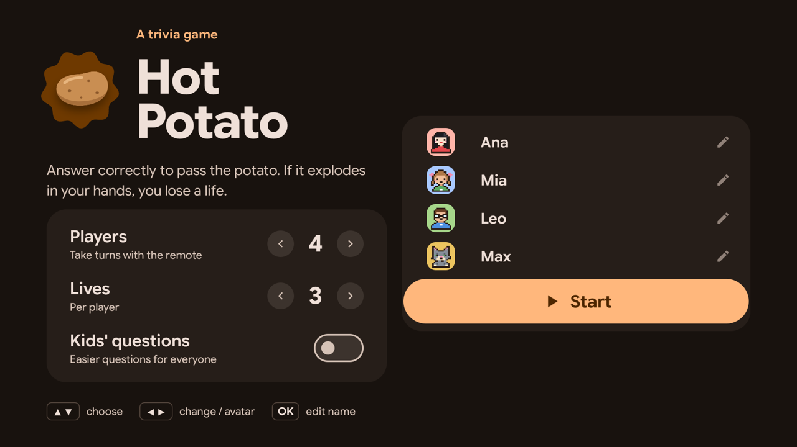
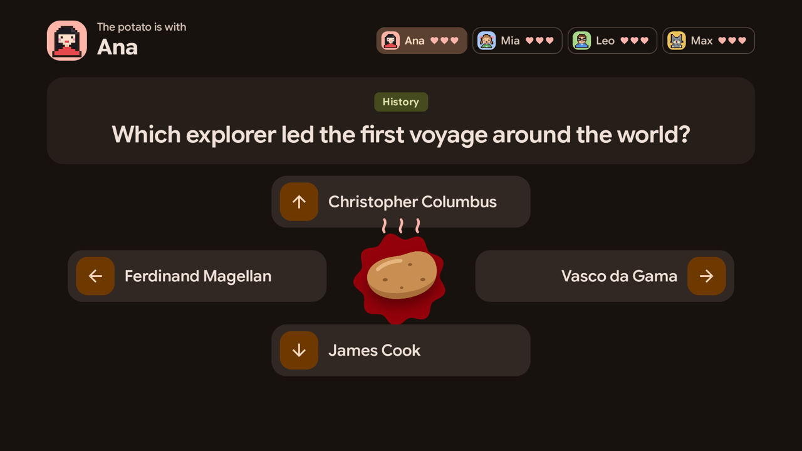
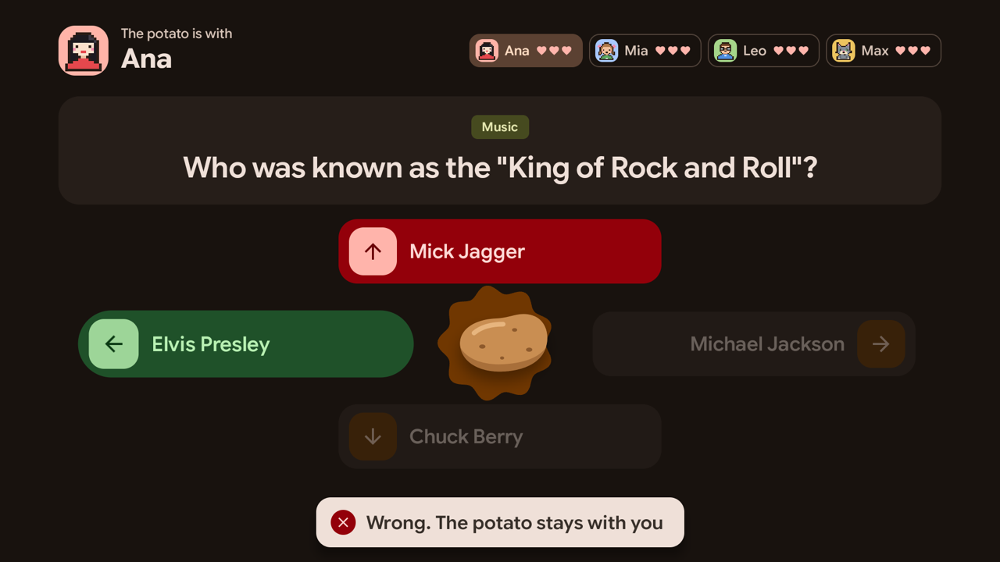
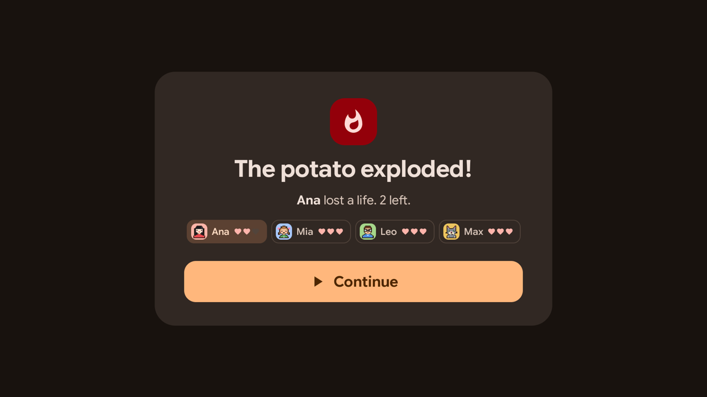

# Hot Potato 🥔🔥

**A party trivia game for Android TV / Google TV, played by passing one remote around the room.**

Answer a question correctly and the hot potato moves on to the next player. Get it wrong and it stays
with you. Nobody knows when it will explode, and whoever is holding it when it does loses a life.
The last player with lives left wins.



## Features

- **2 to 6 players** with 1 to 5 lives each. Pick a name and a pixel-art avatar for each player.
- **About 400 questions per language**, covering geography, history, science, music, sport, general
  knowledge and more.
- **Kids' questions**: a separate, easier question bank for when children are playing.
- **English and Portuguese**: the game follows the TV's language. It uses European Portuguese when the
  TV is set to Portuguese and British English otherwise. Each language has its own questions.
- **Built for the remote**: only the D-pad, OK and Back buttons are needed. No keyboard or phone app.
- Sounds, animations and a potato that visibly heats up as the fuse runs down.

## How to play

1. **Set up the game.** Choose the number of players and lives, and turn on **Kids' questions** if
   you want the easier questions. Select a player to change their avatar (◀ ▶) or name (OK), then
   select **Start**.
2. **Answer the question.** The player holding the potato gets a question with four answers, one for
   each direction on the D-pad. Press ▲ ▼ ◀ or ▶ to answer.

   

3. **Pass the potato.** If you're right, hand the remote to the next player. If you're wrong, the
   potato stays with you and you get another question. After a pass, the next player always has a
   few seconds before the potato can explode on them.

   

4. **Boom.** The potato explodes at a random moment, between 25 and 55 seconds into each round.
   Whoever is holding it loses a life, and a player with no lives left is out.

   

5. **Win.** The last player with lives left wins.

### Controls

| Button | Title screen | During the game |
| --- | --- | --- |
| ▲ ▼ | Move between options and players | Answer |
| ◀ ▶ | Change a value or a player's avatar | Answer |
| OK | Edit a player's name, flip a switch, start | Confirm in menus |
| Back | Exit the app | Pause (resume or go back to the start) |

Names, avatars and settings are saved on the TV for the next game.

## Installing

Hot Potato is not on the Play Store. Download the APK from the
[latest release](https://github.com/jjmluz/hot-potato/releases/latest), or build it yourself, and
install it on the TV with `adb`.

### Requirements

- A TV running **Android TV or Google TV with Android 12 or newer**.
- The **Android SDK** (Android Studio is the easiest way to get it) with `adb` on your `PATH`.
- **JDK 17 or newer** to run Gradle.

### Build

```bash
cd android && ./gradlew assembleRelease
```

The APK ends up in `android/app/build/outputs/apk/release/app-release.apk`. Always use the
**release** build: Jetpack Compose is much slower in debug builds. Local builds are signed with your
debug key, so they install without setting up a keystore. Published releases are signed with the
project's release key, so switching between the two needs an uninstall first.

### Install on the TV

1. On the TV, turn on **Developer options**: go to *Settings → System → About* and select
   *Android TV OS build* seven times.
2. In *Settings → System → Developer options*, turn on **USB debugging** (or **Wireless debugging**).
3. Connect from your computer using the TV's IP address (pair first if your TV asks for it):

   ```bash
   adb connect <tv-ip-address>:5555
   ```

4. Install the APK you downloaded or built:

   ```bash
   adb install -r hot-potato.apk
   ```

Hot Potato then appears in the TV's list of apps. An Android TV emulator from Android Studio works
too.

## Adding or editing questions

Questions live in `android/app/src/main/assets/`, with one folder per language:

| File | Used for |
| --- | --- |
| `en/questions.tsv` | English, main questions |
| `en/questions-kids.tsv` | English, kids' questions |
| `pt/questions.tsv` | Portuguese, main questions |
| `pt/questions-kids.tsv` | Portuguese, kids' questions |

Each line is one question with six fields separated by tabs, and no header:

```
category	question	correct answer	wrong answer	wrong answer	wrong answer
```

The first answer is always the correct one; the game shuffles them on screen. Keep answers short
so they fit their slot, and prefer facts that won't go out of date. The Portuguese banks include
questions about Portugal, while the English banks use international questions instead, so the two
languages don't match line for line.

## Project layout

A native Android app written in Kotlin with Jetpack Compose (foundation and UI only, no Material
library). All app code is in `android/app/src/main/`:

| Path | What it does |
| --- | --- |
| `java/.../Game.kt` | Game logic and state, independent of the UI |
| `java/.../MainActivity.kt` | Remote-control input and app lifecycle |
| `java/.../App.kt`, `SetupScreen.kt`, `GameScreen.kt` | Screens, laid out on a fixed 1920×1080 stage scaled to the display |
| `java/.../Art.kt`, `Theme.kt` | Icons, the potato, colours and typography |
| `java/.../Avatars.kt` | Pixel-art avatars |
| `java/.../Sound.kt` | Sound effects, synthesised at startup and played by a small mixer |
| `res/values/strings.xml`, `res/values-pt/strings.xml` | All on-screen text, in English and Portuguese |
| `assets/` | Question banks |

The Google TV home-screen banners are generated from `android/art/banner.html` with
`android/art/make-banner.sh`.

Code comments are in Portuguese.

## Releases

GitHub Actions checks the question files, lints and builds every push and pull request. Pushing a
version tag publishes a release with a signed APK:

```bash
git tag v1.0.0 && git push origin v1.0.0
```

## License

[MIT](LICENSE)
